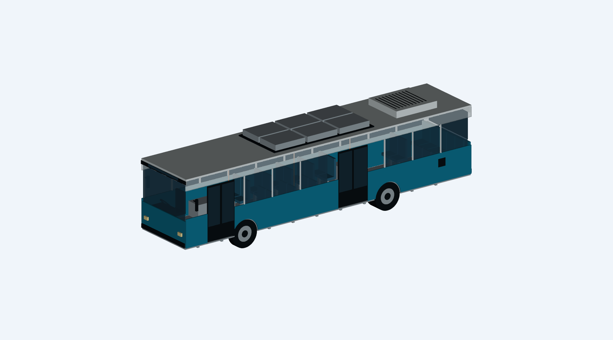

# اتوبوس برقی شهری ۱۲ متری — مدل مفهومی

مدل سه‌بعدی نمایشی با ابعاد فرضی، تهیه‌شده در ۲۲ اکتبر ۲۰۲۶. خروجی STEP شامل قطعات جداگانه نام‌گذاری‌شده و رنگی است.



## دریافت مدل

- [مجموعه STEP](electric_bus_12m.step)
- [گزارش بررسی هندسه](electric_bus_validation.json)
- [کد تولید مدل](build_electric_bus.py)

## ابعاد و چیدمان فرضی

| ویژگی | مقدار |
|---|---:|
| طول اسمی بدنه | ۱۲۰۰۰ میلی‌متر |
| عرض اسمی بدنه بدون آینه | ۲۵۵۰ میلی‌متر |
| ارتفاع اسمی تا محفظه باتری | ۳۳۰۰ میلی‌متر |
| فاصله محورها | ۶۰۰۰ میلی‌متر |
| پیش‌آمدگی جلو / عقب | ۲۵۰۰ / ۳۵۰۰ میلی‌متر |
| قطر فرضی تایر | ۱۰۲۰ میلی‌متر |
| ارتفاع کف | ۵۵۰ میلی‌متر |
| صندلی مسافر / راننده | ۲۵ / ۱ |
| درهای سمت راست | ۲ |
| محفظه باتری روی سقف | ۶ |

سپر، چراغ، آینه و ریزاجزا می‌توانند از ابعاد اسمی بدنه بیرون بزنند. ارتفاع سقف تجهیزات تهویه با تیغه‌های تزئینی حدود ۳۳۰۸ میلی‌متر است. مبدأ مختصات در وسط طول خودرو و روی سطح زمین قرار دارد. محور X طولی، Y عرضی و Z ارتفاع است؛ جلوی خودرو سمت X منفی است. واحد STEP میلی‌متر است.

## اجزای مدل

بدنه و سقف، شیشه‌ها، دو در نمایشی، تیرهای طولی و عرضی شاسی، کف، دو محور، تایر و رینگ با چرخ دوتایی عقب، تعلیق نمادین، موتور عقب، اینورتر، شش محفظه باتری سقفی، محفظه تهویه، صندلی‌ها، کابین راننده، فرمان، دستگیره‌ها، آینه‌ها، چراغ‌ها و درگاه شارژ.

## حدود استفاده

این طرح فقط برای نمایش فرم و چیدمان اولیه است. شاسی، بدنه، فرمان، تعلیق، ترمز، اتصالات، باتری و سامانه برق برای ساخت مهندسی نشده‌اند. محفظه‌های باتری فاقد طراحی سلول، ظرفیت انرژی و مدار الکتریکی هستند. برد، توان، ظرفیت مجاز مسافر، جرم، بار محورها و ایمنی تصادف محاسبه نشده‌اند. مسیر دسترسی، ارگونومی، مقررات اتوبوس و عایق‌کاری ولتاژ بالا بررسی نشده‌اند. اعتبار هندسی فایل به معنی تأیید عملکرد مکانیکی یا الکتریکی نیست.

این پروژه مستقل از مدل قبلی دیفرانسیل ۶ تن است و آن قطعه در این اتوبوس به‌عنوان قطعه تأییدشده به کار نرفته است.

## بازتولید

با Python 3.12 و بسته‌های `cadquery==2.8.0` و `vtk==9.6.2`:

```sh
pip install -r requirements.txt
python build_electric_bus.py generated
```

اسکریپت مجموعه STEP را می‌نویسد، دوباره وارد می‌کند، اعتبار اجسام را بررسی می‌کند و تصویر پیش‌نمایش و گزارش JSON را می‌سازد. بررسی خودکار شامل کنترل تداخل، تحلیل بار یا شبیه‌سازی حرکت نیست.
