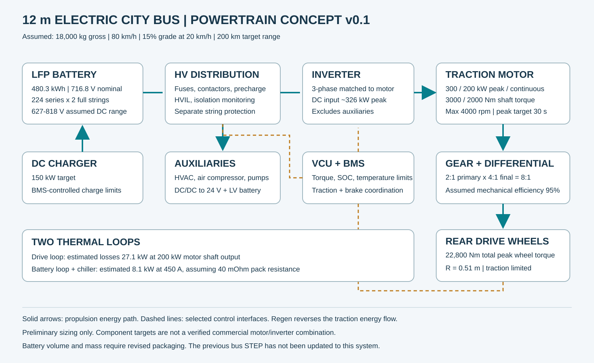

# طرح اولیه قوای محرکه اتوبوس برقی ۱۲ متری

نسخه ۰٫۱ — ۲۲ اکتبر ۲۰۲۶ — واحدها SI مگر در موارد مشخص.

این سند، سایزبندی اولیه و معماری سیستم است. انتخاب نهایی سخت‌افزار، طراحی قابل ساخت چرخ‌دنده‌ها، مدار ساخت باتری و نقشه سیم‌کشی اجرایی در این مرحله انجام نشده‌اند. اعداد مربوط به موتور و اینورتر «نیازمندی طراحی» هستند، نه مشخصات یک محصول تأییدشده.

## مبنای طراحی

جرم کل ۱۸۰۰۰ کیلوگرم شامل خودرو، باتری، سرنشین و بار؛ سرعت محدودشده ۸۰ کیلومتر بر ساعت؛ شیب هدف ۱۵٪ با سرعت ۲۰ کیلومتر بر ساعت و توانایی شروع حرکت؛ برد هدف ۲۰۰ کیلومتر. شعاع مؤثر فرضی چرخ ۰٫۵۱ متر است. شعاع تحت بار واقعی باید از تایر انتخابی گرفته شود.

فرض‌ها: Crr=0.008، CdA=6 m²، چگالی هوا 1.2 kg/m³، بازده انتقال مکانیکی 0.95، بازده موتور 0.94 و اینورتر 0.98؛ ضریب جرم دورانی 1.05 برای شتاب و مصرف لحظه‌ای تجهیزات جانبی ۲۰ کیلووات. این بازده‌های ثابت جایگزین نقشه عملکرد واقعی نیستند.

## معماری منتخب

موتور برقی و کاهنده در مجموعه محرک عقب، با نسبت اولیه ۲:۱ و نسبت نهایی دیفرانسیل ۴:۱؛ نسبت کل ۸:۱. جهت نصب و انتقال زاویه‌ای متناسب با جانمایی سازنده تعیین می‌شود. کلاچ راه‌اندازی و گیربکس چندسرعته در این مفهوم لازم نیستند. معکوس‌کردن حرکت با کنترل اینورتر انجام می‌شود.

پک باتری ← جعبه توزیع HV و حفاظت ← اینورتر ← موتور ← کاهنده ← دیفرانسیل ← پلوس و چرخ.

VCU درخواست راننده را با محدودیت‌های BMS، دمای اجزا، سرعت چرخ و وضعیت ترمز هماهنگ می‌کند. بازیابی انرژی تنها با ظرفیت پذیرش باتری فعال است؛ ترمز اصطکاکی باید مستقل از امکان بازیابی پاسخ‌گوی نیاز ترمز باشد.



## نیازمندی اجزای اصلی

| جزء | هدف اولیه |
|---|---|
| موتور کشش | ۳۰۰ کیلووات پیک، ۲۰۰ کیلووات پیوسته در شفت موتور |
| گشتاور موتور | ۳۰۰۰ نیوتن‌متر پیک، ۲۰۰۰ نیوتن‌متر پیوسته |
| مدت پیک | هدف ۳۰ ثانیه؛ نیازمند تأیید سازنده و مدل حرارتی |
| دور پایه / دور حداکثر | حدود ۹۵۵ / ۴۰۰۰ دور بر دقیقه |
| منحنی فرضی | گشتاور ثابت تا دور پایه، سپس توان ثابت تا دور حداکثر |
| انتقال | نسبت کل ۸:۱؛ بازده فرضی ۹۵٪ |
| گشتاور خروجی کل روی چرخ‌های محرک | پیک ۲۲۸۰۰ نیوتن‌متر پس از تلفات |
| نیروی کشش پیک | حدود ۴۴٫۷ کیلونیوتن پیش از محدودیت چسبندگی |
| اینورتر | سه‌فاز؛ سازگار با موتور و ولتاژ DC حدود ۶۲۷ تا ۸۱۸ ولت؛ هدف ورودی با حاشیه تا رده سیستم ۱۰۰۰ ولت |
| توان DC برای کشش پیک | حدود ۳۲۶ کیلووات، به‌علاوه مصارف جانبی |
| باتری و توزیع DC | هدف ۴۵۰ آمپر پیوسته و ۶۰۰ آمپر کوتاه‌مدت، مشروط به بررسی حرارتی و سلول |
| شارژ DC | هدف اولیه ۱۵۰ کیلووات، پروتکل و کانکتور تابع زیرساخت منتخب |
| شبکه کم‌ولتاژ | ۲۴ ولت از DC/DC و باتری کمکی؛ توان تابع فهرست مصرف‌کنندگان |

گشتاورهای موتور در جدول در شفت موتور تعریف شده‌اند؛ گشتاور خروجی محصولات دارای کاهنده داخلی نباید مستقیماً به‌جای آن‌ها گذاشته شود. جریان فاز اینورتر از جریان DC به دست نمی‌آید و بدون ثابت گشتاور، ولتاژ برگشتی و نقشه موتور تعیین نشده است.

## محاسبات کشش

با θ=atan(شیب)، v برحسب متر بر ثانیه و r شعاع مؤثر:

```text
F = m g (sin θ + Crr cos θ) + 0.5 ρ CdA v² + 1.05 m a
Tmotor = F r / (i ηgear)
Pmotor = F v / ηgear
nmotor = 60 v i / (2πr)
Tavailable = min(Tlimit, Plimit/ω)
```

| حالت | نیروی لازم | گشتاور موتور لازم | توان شفت لازم | دور موتور |
|---|---:|---:|---:|---:|
| سطح صاف، ۸۰ km/h | ۳٫۱۹ kN | ۲۱۴ Nm | ۷۴٫۶ kW | ۳۳۲۹ rpm |
| شیب ۱۵٪، سرعت ۲۰ km/h | ۲۷٫۷۰ kN | ۱۸۵۹ Nm | ۱۶۲٫۰ kW | ۸۳۲ rpm |
| شروع حرکت روی شیب ۱۵٪، بدون شتاب | ۲۷٫۵۹ kN | ۱۸۵۱ Nm | صفر در لحظه سکون | صفر |
| شتاب ۰٫۵ m/s² در ۵۰ km/h روی سطح صاف | ۱۱٫۵۶ kN | ۷۷۶ Nm | ۱۶۹٫۰ kW | ۲۰۸۰ rpm |

صفر بودن توان مکانیکی در سکون به معنی صفر بودن جریان یا تلفات نیست. گشتاور سکون پیوسته باید جداگانه تأیید شود. حاشیه گشتاور پیوسته روی شیب ۱۵٪ حدود ۷٫۶٪ است؛ افت توان در گرما می‌تواند این حاشیه را از بین ببرد.

سقف دور موتور معادل حدود ۹۶ km/h است؛ سرعت خودرو در نرم‌افزار به ۸۰ محدود می‌شود. مدل شتاب ایده‌آل با محدودیت آسایش ۰٫۸ m/s²، زمان ۰ تا ۵۰ حدود ۱۷٫۴ ثانیه می‌دهد؛ این عدد بدون تأخیر، محدودیت حرارتی، تغییر شیب یا لغزش است و نتیجه آزمون خودرو نیست.

بار استاتیکی فرضی عقب ۱۱٫۵ تن و جلو ۶٫۵ تن است؛ ظرفیت اسمی قطعات باید با بارهای دینامیکی و ضرایب طراحی انتخاب شود. نسبت کشش پیک به وزن استاتیکی عقب حدود ۰٫۴۰ است و روی سطح کم‌اصطکاک باید گشتاور محدود شود. انتقال بار، مرکز جرم و توزیع واقعی جرم هنوز مدل نشده‌اند. دیفرانسیل نمایشی ۶ تن قبلی برای این محور عقب انتخاب نشده است. قفل خودکار دیفرانسیل نیز در این مرحله جزو طرح نیست؛ سازگاری آن با پایداری، ترمز و بازیابی باید جداگانه بررسی شود.

## باتری، برد و جانمایی

مفهوم الکتریکی: LFP با سلول فرضی ۳٫۲ ولت و ۳۳۵ آمپرساعت، دو رشته مستقل ۲۲۴ سلولی سری و اتصال موازی کنترل‌شده در توزیع HV؛ در مجموع ۴۴۸ سلول و 670 Ah. این توصیف دو رشته کامل سری است، نه الزاماً موازی‌کردن تک‌تک سلول‌ها. سلول تجاری انتخاب نشده است.

ولتاژ نامی ۷۱۶٫۸ ولت؛ محدوده طراحی فرضی سلول ۲٫۸ تا ۳٫۶۵ ولت، معادل ۶۲۷٫۲ تا ۸۱۷٫۶ ولت. محدوده مجاز واقعی تابع دیتاشیت سلول و BMS است. انرژی نامی ۴۸۰٫۲۵۶ کیلووات‌ساعت؛ پنجره کار فرضی SOC برابر ۱۰ تا ۹۰٪؛ انرژی قابل استفاده در آغاز عمر ۳۸۴٫۲ و در SOH=80% حدود ۳۰۷٫۴ کیلووات‌ساعت است.

| مصرف فرضی شامل جانبی‌ها | برد آغاز عمر | برد در SOH=80% |
|---|---:|---:|
| ۱٫۳ kWh/km | ۲۹۶ km | ۲۳۶ km |
| ۱٫۵ kWh/km | ۲۵۶ km | ۲۰۵ km |
| ۱٫۸ kWh/km | ۲۱۳ km | ۱۷۱ km |
| ۲٫۰ kWh/km | ۱۹۲ km | ۱۵۴ km |

بنابراین هدف ۲۰۰ کیلومتر در پایان عمر فقط در سناریوی مصرف حدود ۱٫۵ kWh/km یا کمتر حاصل می‌شود. تضمین برد به سیکل مسیر، دما، توقف‌ها، تهویه و اندازه‌گیری مصرف نیاز دارد. مصرف‌های جدول فرض سناریو هستند؛ از مدل حرکت با سرعت ثابت استخراج نشده‌اند و انرژی تجهیزات جانبی نباید دوباره به آن‌ها اضافه شود.

در شش محفظه، هر رشته از سه بخش ۷۴، ۷۵ و ۷۵ سلولی سری تشکیل می‌شود؛ رشته دوم مشابه است. انرژی بخش‌ها به‌ترتیب حدود ۷۹٫۳، ۸۰٫۴ و ۸۰٫۴ kWh است. هر رشته به سنجش جریان، حفاظت، کنتاکتور و هماهنگی BMS نیاز دارد؛ اتصال مستقیم رشته‌ها با SOC متفاوت مجاز فرض نشده است.

با فرض چگالی انرژی کل پک ۱۴۰ Wh/kg، جرم پک حدود ۳٫۴۳ تن است. با فرض ۲۰۰ Wh/L، حجم حدود ۲٫۴۰ m³ است. این‌ها فرض‌های بودجه‌ای هستند، نه مشخصات یک باتری موجود.

شش محفظه CAD قبلی تنها ۱٫۴۲ m³ حجم خارجی دارند؛ برای این ظرفیت کافی تلقی نمی‌شوند. هدف جدید جانمایی، شش محفظه حدود ۱۶۰۰×۱۰۰۰×۲۸۰ میلی‌متر در سه ردیف و دو ستون، با حجم خارجی ۲٫۶۹ m³ است. فضای داخلی، خنک‌کاری، فاصله عایقی و سرویس هنوز باید کنترل شوند. این تغییر ارتفاع سقف را افزایش می‌دهد و در STEP بدنه قبلی اعمال نشده است. حمل حدود ۳٫۴ تن روی سقف نیازمند تحلیل سازه سقف، مرکز جرم، پایداری و بار محورهاست؛ انتقال بخشی از باتری به پایین خودرو باید در مرحله جانمایی مقایسه شود. بودجه جرم ۱۸ تن فقط در صورت جاگرفتن این جرم باتری و بار مسافر در جرم کل معتبر می‌ماند.

## برق، کنترل و خنک‌کاری

جریان DC در حداقل ولتاژ، با ۲۰ kW تجهیزات جانبی، حدود ۵۵۱ آمپر در پیک و ۳۷۸ آمپر در حالت پیوسته است. هدف ۶۰۰/۴۵۰ آمپر نیازمندی اولیه پک و توزیع است؛ آمپراژ فیوز، سطح مقطع کابل، کنتاکتور و باس‌بار از این اعداد به‌تنهایی انتخاب نشده است. جریان اتصال کوتاه، منحنی قطع، دما، طول کابل، افت ولتاژ و هماهنگی حفاظتی باید مشخص شوند.

معماری حفاظت شامل قطع سرویس، حفاظت هر رشته، کنتاکتورهای اصلی، پیش‌شارژ، پایش عایقی، HVIL، اندازه‌گیری جریان و ولتاژ، تخلیه باس و قطع در رخداد تصادف است. مقدار مقاومت پیش‌شارژ بدون ظرفیت DC-link و زمان مجاز تعیین نشده است. شاخه‌های مستقل برای کشش، شارژ، DC/DC و تجهیزات جانبی ولتاژ بالا در نظر گرفته می‌شوند. این فهرست نقشه اجرایی برق نیست.

ترتیب مفهومی راه‌اندازی: بررسی BMS/عایق/HVIL و وضعیت ترمز، پیش‌شارژ با کنترل ولتاژ باس، وصل کنتاکتور اصلی پس از تحقق شرایط، تأیید آمادگی اینورتر، سپس اجازه گشتاور. خاموش‌کردن با کاهش گشتاور، قطع کنترل‌شده و تأیید تخلیه انجام می‌شود. در خطا، رفتار قطع تابع شدت خطا و تحلیل ایمنی است.

برای ترمز احیایی، محدودیت شارژ BMS، SOC، دما و چسبندگی مقدم است. هنگام لغزش، پر بودن باتری یا نبود ظرفیت شارژ، بازیابی کاهش می‌یابد و ترمز اصطکاکی جبران می‌کند. توان بازیابی نهایی تا دریافت نقشه موتور و حد پذیرش شارژ باتری تعیین نشده است.

دو حلقه حرارتی مستقل پیشنهاد می‌شود: حلقه موتور/اینورتر/کاهنده و حلقه باتری با چیلر. تلفات برآوردی زنجیره محرک در خروجی شفت ۲۰۰ kW حدود ۲۷٫۱ kW است. با مقاومت داخلی فرضی کل پک ۴۰ mΩ، گرمای پک در ۴۵۰ A حدود ۸٫۱ kW است. هدف اولیه ظرفیت دفع حرارت محرک ۳۵ kW و باتری ۱۲ kW در شرایط محیطی مشخص است؛ این اعداد بدون تعیین دمای محیط، دبی و عملکرد مبدل، انتخاب قطعه محسوب نمی‌شوند.

شارژ ۱۰ تا ۹۰٪ در توان ثابت ۱۵۰ kW و بازده فرضی ۹۵٪ حدود ۲٫۷ ساعت زمان ایده‌آل می‌خواهد؛ کاهش توان انتهای شارژ، دما و مصرف جانبی زمان واقعی را افزایش می‌دهند.

## فایل‌ها و بازتولید

- `calculate_powertrain.py`: محاسبات قابل بازتولید، بدون وابستگی خارجی.
- `powertrain_calculations.json`: ورودی‌ها و نتایج عددی.
- `tractive_force_curve.csv`: نیروهای کشش پیوسته و پیک، دور موتور و مقاومت سطح صاف از صفر تا ۸۰ km/h.
- `powertrain_architecture.svg`: دیاگرام معماری.

اجرا: `python calculate_powertrain.py`. چهار حالت کشش با مدل فرضی مقایسه و کنترل می‌شوند. محاسبات شامل طراحی دندانه، یاتاقان و پلوس، تحلیل FEA، تست حرارتی یا ارزیابی ایمنی و مقررات نیستند.

## منابع مرجع

معماری موتور مرکزی همراه اینورتر و استفاده با اکسل متعارف، در [صفحه رسمی ZF CeTrax](https://www.zf.com/products/en/cv/products_76371.html) دیده می‌شود. اعداد این طرح مشخصات CeTrax نیستند.

برای مقیاس توان و گشتاور کاربرد اتوبوس، [راهنمای رسمی Dana، جدول TM4 SUMO](https://www.dana.com/globalassets/resource-library/commercial-vehicle/spec-sheets/commercial-vehicle-spec-guide.pdf) مرجع مقایسه است؛ سازگاری هیچ مدل تجاری با منحنی و ولتاژ این طرح ادعا نشده است.

مطالعه [DOE/NREL، مارس ۲۰۲۴](https://www.energy.gov/sites/default/files/2024-03/2024.03.18%20NREL%20LBNL%20Kevala%20DOE%20Multi-State%20Transportation%20Electrification%20Impact%20Study%20FINAL%20DOCKET.pdf) نرخ فرضی ۲٫۲۸ kWh/mile، تقریباً ۱٫۴۲ kWh/km، برای اتوبوس برقی شهری به کار می‌برد. این نرخ تنها معیار مقایسه است و مصرف همین خودرو یا تضمین برد آن نیست.
